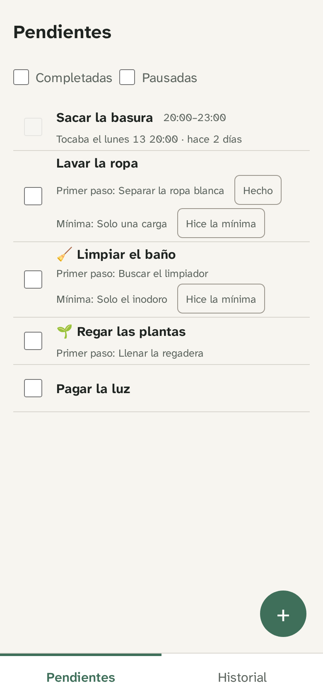
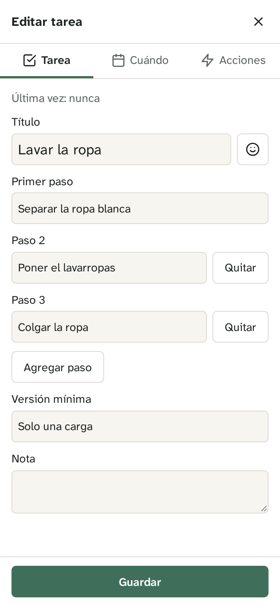
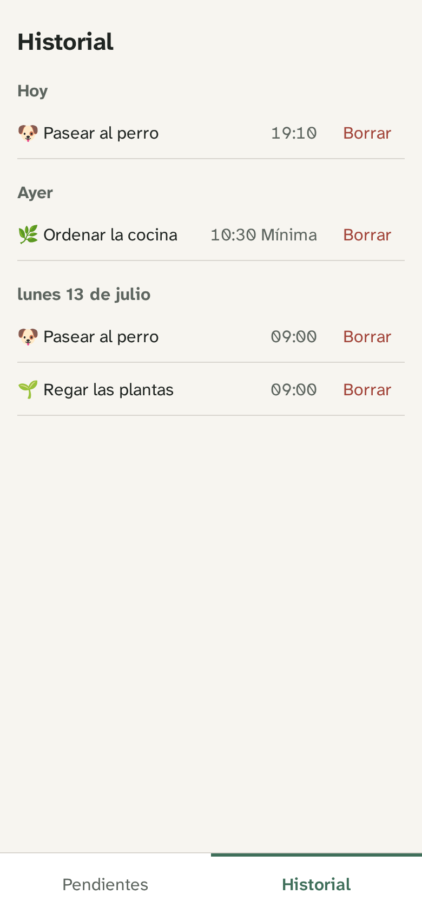

<div align="center">


# Tareas Hogar

**Una lista de tareas del hogar tranquila, para cabezas que olvidan, se traban o se abruman.**

Una app web instalable (PWA) pensada para personas adultas con TDAH, autismo y altas capacidades,<br>
también para quienes comparten casa. Gratis, de código abierto y funciona sin conexión.

**[Probarla](https://tareas-hogar-reimon.web.app)** · [Read in English](README.md) · [Publicar tu propia copia](#publicar-tu-propia-copia)

[](LICENSE)


</div>

<p align="center">
  
  &nbsp;
  
  &nbsp;
  
</p>

## Por qué

La mayoría de las apps de tareas suponen que lo difícil es acordarse. Para mucha gente lo difícil es **empezar**, y lo segundo más difícil es **no sentirse mal** por lo que quedó atrás. Tareas Hogar está construida alrededor de las dos cosas:

- **Las tareas que se repiten no se pierden.** «¿Cuándo limpié el baño por última vez?» tiene respuesta, y la tarea vuelve sola.
- **La lista muestra primero lo que importa ahora**, sin ruido: sin contadores, sin globitos rojos, sin rachas que se cortan.
- **Empezar cuesta menos que leer el título.** Cada tarea puede mostrar su primer paso concreto, y las tareas largas avanzan de a un paso.
- **Hacer menos también cuenta.** Una tarea puede tener una versión mínima («Solo el inodoro»); «Hice la mínima» la da por hecha y el historial lo recuerda.
- **Sin culpa.** Una tarea atrasada dice «Tocaba el lunes 13 20:00 · hace 2 días»: un dato, no una advertencia.

## Funciones

| | |
|---|---|
| 🔁 **Tareas puntuales y periódicas** | Cada N días u horas, o ciertos días de la semana o del mes. |
| 🕗 **Horarios** | Una tarea puede tener sentido solo en una franja (sacar la basura de 20:00 a 23:00). |
| 👣 **Primer paso y pasos** | Se ven en la fila, de a uno, con «Hecho» para avanzar. |
| 🪶 **Versión mínima** | Una versión chica de la tarea que también cuenta como hecha. |
| ⏸️ **Posponer y pausar** | Sacar una tarea del medio sin perderla ni perder su ritmo. |
| 📜 **Historial con deshacer** | Todo lo completado, agrupado por día; cualquier completado se puede deshacer. |
| 📶 **Sin conexión** | Funciona sin conexión y se sincroniza entre dispositivos cuando vuelve. |
| 📱 **Instalable** | Se agrega a la pantalla de inicio y queda en vertical, como una app nativa. |
| 🔤 **Legible en todos lados** | La fuente Atkinson Hyperlegible y los emoji vienen con la app, así se ve igual en cualquier dispositivo. |

> [!NOTE]
> El enlace **Probarla** es la instancia personal del autor: cualquiera puede entrar con Google y solo ve sus propias tareas, pero no hay garantías y los datos pueden borrarse. Para usarla en serio, conviene [publicar una copia propia](#publicar-tu-propia-copia): lleva unos minutos y un proyecto gratuito de Firebase.

La app está en español. El código, los tests, los escenarios Gherkin y los documentos están en inglés. Qué hace la app, regla por regla, está en [`docs/spec.md`](docs/spec.md).

## Diseño basado en evidencia

La versión 3 se diseña a partir de investigación publicada, no de intuiciones. La base está en [`docs/research/v3/`](docs/research/v3/): cuatro documentos sobre TDAH, autismo, altas capacidades y doble excepcionalidad, y sobre hogares compartidos y apps existentes. Cada hallazgo indica la fuerza de su evidencia y sus fuentes. El [`README`](docs/research/v3/README.md) de esa carpeta explica el método y cómo ampliarlo.

Algunos principios que salieron de ahí:

- **Bajar el costo de empezar:** un primer paso concreto, una tarea a la vez.
- **Cero culpa:** sin rachas que se cortan ni contadores de atraso que crecen.
- **Invitar, no ordenar:** la persona decide de qué se entera y cuándo.
- **Tono adulto:** sin puntos, medallas ni mascotas.

## Correrla en tu computadora

Requisitos: Node.js 26 y la [CLI de Firebase](https://firebase.google.com/docs/cli).

```sh
npm ci
npm run emulators   # Auth y Firestore locales, en otra terminal
npm run dev
```

La app de desarrollo usa los emuladores de Firebase, así que no hace falta una cuenta.

## Publicar tu propia copia

1. Crear un proyecto en la [consola de Firebase](https://console.firebase.google.com/) con Authentication (Google), Firestore y Hosting.
2. Copiar `.env.production.example` a `.env.production` y completarlo con la configuración web del proyecto.
3. Copiar `.firebaserc.example` a `.firebaserc` y poner el ID del proyecto en `prod`.
4. `npm run deploy` publica la app y las reglas de Firestore.

## Cómo se desarrolla

Cada función se especifica antes de construirse, y cada regla se prueba con mutación. Cada función pasa por un pipeline de diez roles (análisis, especificación, Gherkin, implementación, limpieza, arquitectura, endurecimiento y QA), con compuertas deterministas de cobertura, complejidad (CRAP), duplicación y mutación. El detalle está en [`CLAUDE.md`](CLAUDE.md) y [`docs/pipeline/`](docs/pipeline/) (en inglés).

| Comando | Hace |
|---|---|
| `npm test` | Tests unitarios y de aceptación generados desde `features/*.feature` |
| `npm run test:props` | Tests de propiedades |
| `npm run check:arch` | Reglas de dependencias entre capas |
| `npm run qa` | Suite de Playwright contra los emuladores de Firebase |

Las herramientas de calidad vienen de [Acceptance Pipeline Specification](https://github.com/unclebob/Acceptance-Pipeline-Specification), [crapper](https://github.com/unclebob/crapper), [dryer](https://github.com/unclebob/dryer) y [mutator](https://github.com/unclebob/mutator). El orquestador del pipeline (`bdd-pipeline`) todavía no está publicado, así que por ahora las compuertas no se pueden correr fuera del entorno original. Los tests y la suite de QA sí.

## Línea de tiempo

Las fechas son las de publicación del cambio en `v3`; la historia anterior al 2026-11-12 quedó unida en un único lanzamiento público.

| Fecha | Cambio |
|---|---|
| Antes del 2026-11-12 | **Versión 2**: tareas puntuales y periódicas, horarios, posponer y pausar, historial con deshacer, sincronización sin conexión, fuente y emoji incluidos, orientación vertical, panel para el celular. |
| 2026-11-12 | Lanzamiento público (AGPL-3.0). Migración a SvelteKit 3 y Vite 8. Se escribe el plan de la v3 a partir de la investigación en `docs/research/v3/`, como épicas ordenadas. |
| 2026-11-13 | **Estado sin culpa** (épica E2): las tareas atrasadas dicen «Tocaba …» con una fecha, no «Atrasada»; menos de un minuto dice «ahora». **Primer paso** y **pasos de a uno** (E3). |
| 2026-11-15 | **Versión mínima** y «Hice la mínima» (E4, primera mitad); aparece en el historial. Primer despliegue de la v3. |
| 2026-11-16 | Decisión: el código, los tests, el Gherkin y los documentos pasan al inglés; solo el texto de la app queda en español. |
| 2026-11-17 | **Se quitan las etiquetas y el esfuerzo** (no se usaban): spec, código, tests y los campos guardados. |
| 2026-11-18 | Despliegue; se borran de los datos de producción los campos viejos de etiquetas y esfuerzo. Empieza la migración al inglés del código, los comentarios y el Gherkin. |
| 2026-11-20 | **Se quitan las anotaciones** (la nota «me sirvió / me molestó»): desaparece la tercera pestaña y `/anotaciones` redirige. Las épicas se juzgan ahora por lo que la gente cuenta y por los datos guardados. Despliegue; se borran los datos viejos. |
| 2026-11-20 | Termina la migración al inglés: features, procedimientos de QA, paquetes, spec y documentos del pipeline renombrados y traducidos. |
| 2026-11-22 | La ruta `/historial` pasa a ser `/history`. Despliegue. |

Lo que viene está en [`docs/v3/plan.md`](docs/v3/plan.md): empezar una tarea sin comprometerse a terminarla y las épicas siguientes.

## Contribuir

Los issues son bienvenidos: errores, ideas y, sobre todo, relatos de qué ayuda o qué estorba en el uso diario. Se pueden escribir en español. Los pull requests también son bienvenidos, después de acordarlos en un issue. Ver [`CONTRIBUTING.md`](CONTRIBUTING.md) (en inglés).

## Licencia

[AGPL-3.0](LICENSE). Se puede usar, modificar y alojar. Quien publique una versión modificada, también como servicio web, debe compartir su código fuente con la misma licencia.
