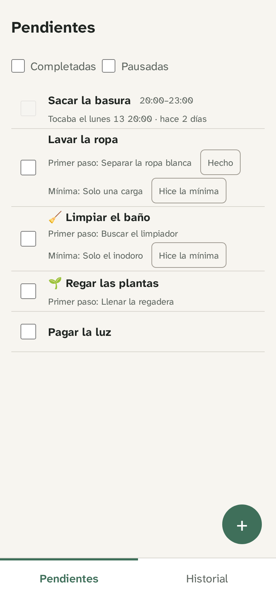
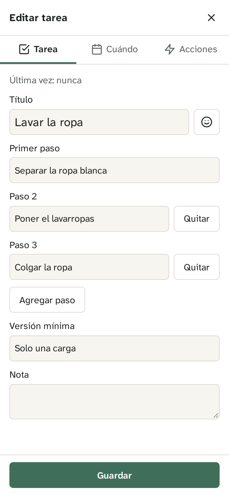
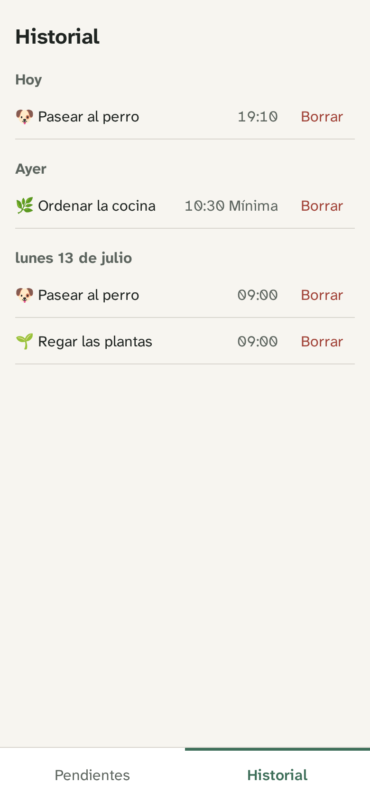

<div align="center">


# Tareas Hogar

**A calm household task list for brains that forget, freeze or get overwhelmed.**

An installable web app (PWA) designed with adults with ADHD, autism and high abilities in mind,<br>
including people who share a home. Free, open source, offline-first.

**[Try it](https://tareas-hogar-reimon.web.app)** · [Leer en español](README.es.md) · [Run your own copy](#publish-your-own-copy)

[](LICENSE)


</div>

<p align="center">
  
  &nbsp;
  
  &nbsp;
  
</p>

## Why

Most to-do apps assume that the hard part is remembering. For many people the hard part is **starting**, and the second hardest is **not feeling bad** about what slipped. Tareas Hogar is built around both:

- **Recurring tasks do not get lost.** "When did I last clean the bathroom?" has an answer, and the task comes back on its own.
- **The list shows what matters now**, first, with no noise: no counters, no red badges, no streaks to break.
- **Starting is cheaper than reading the title.** Each task can show its first concrete step, and longer tasks advance one step at a time.
- **Doing less still counts.** A task can have a minimal version («Solo el inodoro»); «Hice la mínima» marks it done and the history remembers it.
- **No guilt.** A late task reads «Tocaba el lunes 13 20:00 · hace 2 días», a fact, not a warning.

## Features

| | |
|---|---|
| 🔁 **One-off and recurring tasks** | Every N days or hours, or on chosen days of the week or month. |
| 🕗 **Schedules** | A task can only make sense in a time window (take out the trash 20:00–23:00). |
| 👣 **First step and steps** | Shown on the row, one at a time, with «Hecho» to advance. |
| 🪶 **Minimal version** | A small version of the task that also counts as done. |
| ⏸️ **Postpone and pause** | Move a task out of the way without losing it or its rhythm. |
| 📜 **History with undo** | Everything completed, grouped by day; any completion can be undone. |
| 📶 **Offline-first** | Works without connection and syncs across devices when it comes back. |
| 📱 **Installable** | Add it to the home screen; it stays in portrait like a native app. |
| 🔤 **Readable everywhere** | Atkinson Hyperlegible and emoji are bundled, so it looks the same on every device. |

> [!NOTE]
> The **Try it** link is the author's personal instance: anyone can sign in with Google and only sees their own tasks, but there are no guarantees and data may be deleted. For real use, [deploy your own copy](#publish-your-own-copy); it takes a few minutes and a free Firebase project.

The app is in Spanish. Code, tests, Gherkin scenarios and documents are in English. What the app does, rule by rule, is in [`docs/spec.md`](docs/spec.md).

## Evidence-based design

Version 3 is designed from published research, not from hunches. The base is in [`docs/research/v3/`](docs/research/v3/): four documents on ADHD, autism, high abilities and twice-exceptionality, and shared households and existing apps. Each finding states the strength of its evidence and its sources. The [`README`](docs/research/v3/README.md) of that folder explains the method and how to extend it.

Some principles that came out of it:

- **Lower the cost of starting:** a concrete first step, one task at a time.
- **Zero guilt:** no streaks that break and no overdue counters that grow.
- **Invite, do not order:** the person decides what they are notified about and when.
- **Adult tone:** no points, badges or mascots.

## Run it on your computer

Requirements: Node.js 26 and the [Firebase CLI](https://firebase.google.com/docs/cli).

```sh
npm ci
npm run emulators   # local Auth and Firestore, in another terminal
npm run dev
```

The development app uses the Firebase emulators, so no account is needed.

## Publish your own copy

1. Create a project in the [Firebase console](https://console.firebase.google.com/) with Authentication (Google), Firestore and Hosting.
2. Copy `.env.production.example` to `.env.production` and fill it in with your project's web configuration.
3. Copy `.firebaserc.example` to `.firebaserc` and put your project ID in `prod`.
4. `npm run deploy` publishes the app and the Firestore rules.

## How it is developed

Every feature is specified before it is built, and every rule is tested by mutation. Each feature goes through a pipeline of ten roles (analysis, specification, Gherkin, implementation, cleanup, architecture, hardening and QA), with deterministic gates for coverage, complexity (CRAP), duplication and mutation. The detail is in [`CLAUDE.md`](CLAUDE.md) and [`docs/pipeline/`](docs/pipeline/).

| Command | Does |
|---|---|
| `npm test` | Unit tests and acceptance tests generated from `features/*.feature` |
| `npm run test:props` | Property tests |
| `npm run check:arch` | Dependency rules between layers |
| `npm run qa` | Playwright suite against the Firebase emulators |

The quality tools come from [Acceptance Pipeline Specification](https://github.com/unclebob/Acceptance-Pipeline-Specification), [crapper](https://github.com/unclebob/crapper), [dryer](https://github.com/unclebob/dryer) and [mutator](https://github.com/unclebob/mutator). The pipeline orchestrator (`bdd-pipeline`) is not published yet, so for now the gates cannot be run outside the original environment. The tests and the QA suite can.

## Timeline

Dates are when the change was published on `v3`; the history before 2026-11-12 was squashed into a single public release.

| Date | Change |
|---|---|
| Before 2026-11-12 | **Version 2**: one-off and recurring tasks, schedules, postpone and pause, history with undo, offline sync, bundled font and emoji, portrait orientation, mobile panel. |
| 2026-11-12 | Public release (AGPL-3.0). Migration to SvelteKit 3 and Vite 8. The v3 plan is written from the research in `docs/research/v3/`, as ordered epics. |
| 2026-11-13 | **Guilt-free status** (epic E2): late tasks read «Tocaba …» with a date, not «Atrasada»; under a minute reads «ahora». **First step** and **steps one at a time** (E3). |
| 2026-11-15 | **Minimal version** and «Hice la mínima» (E4, first half); it appears in the history. First deploy of v3. |
| 2026-11-16 | Decision: code, tests, Gherkin and documents move to English; only app text stays in Spanish. |
| 2026-11-17 | **Labels and effort removed** (they were not used): spec, code, tests and the stored fields. |
| 2026-11-18 | Deploy; the old label and effort fields are deleted from production data. English migration of code, comments and Gherkin begins. |
| 2026-11-20 | **Annotations removed** (the «me sirvió / me molestó» note): the third tab is gone and `/anotaciones` redirects. Epics are now judged by what people report and by stored data. Deploy; the old data is deleted. |
| 2026-11-20 | English migration finished: features, QA procedures, packages, spec and pipeline documents renamed and translated. |
| 2026-11-22 | The `/historial` route becomes `/history`. Deploy. |
| 2026-11-24 | **Block rescheduling** (E6, second half): «Reprogramar vencidas» in the ⋮ menu reschedules every overdue recurring task at once, with a preview and a 5-second undo. **«Completadas» and «Pausadas»** move from checks above the list into the ⋮ menu, and a completed one-off task no longer has a row in «Pendientes» (it is reached from the history). Deploy. |

What comes next is in [`docs/v3/plan.md`](docs/v3/plan.md): starting a task without committing to finish it, and the later epics.

## Contributing

Issues are welcome: bugs, ideas, and especially reports of what helps or gets in the way in daily use. Pull requests are welcome too, after agreeing on them in an issue. See [`CONTRIBUTING.md`](CONTRIBUTING.md).

## License

[AGPL-3.0](LICENSE). You can use it, modify it and host it. If you publish a modified version, also as a web service, you must share its source code under the same license.
